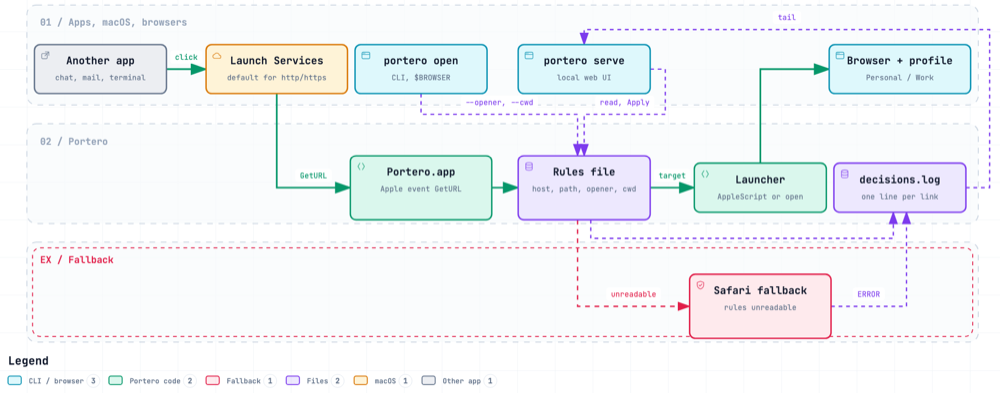

<p align="left"></p>

# Portero

Portero is a default-browser router for macOS. It registers itself as the handler for `http` and
`https` links and opens every link that comes from another app (chat, mail, calendar, terminal,
scripts, `$BROWSER`) in the browser and profile that a rule picks. One link, one place, every time.

## What it does

- Routes by host (wildcards), by path prefix and by the app that opened the link (bundle id). Links opened
  from a shell through `portero open` can also be routed by the working directory.
- Targets any installed browser and, where the browser has them, a specific profile, space or
  container.
- Supports the new generation of browsers as well as the classic ones. Browsers that run as a single
  instance and ignore command-line arguments (Dia, Arc and the like) are driven through their
  AppleScript dictionary, so a profile can still be chosen.
- Keeps the rules in one plain file on the Mac; the file can live in iCloud Drive to be shared between
  Macs.
- Opens local HTML files too (Open With, drag onto the icon): they go to the default browser and profile.
- Logs every routing decision. A missing or broken rules file never swallows a link: it opens in Safari and the
  error is logged.
- Ships a CLI: `portero open <url>`, `portero rules`, `portero sync`, `portero serve`, usable as `$BROWSER`.
- `portero serve` runs a local web UI on a loopback address: a live diagram of where links went and an editor for
  the rules file with validation, a test match and a backup of the previous file, plus a Settings page for the default browser and iCloud sync. See [docs/ui.md](docs/ui.md). Access needs the single-use link printed by the command (loopback is reachable by other local users and containers).

## How it works

macOS hands every `http`/`https` link from another app to Portero.app as an Apple event, together with the
sender's process, from which Portero reads the opener's bundle id. The first rule that matches the host, path and
opener picks the browser and profile; a launcher opens the link there and the decision goes to
`~/.config/portero/decisions.log` with the rule's name (`Work / GitHub organisation` for a rule inside a group). When the rules file cannot be read, the link opens in Safari and an `ERROR`
line is logged.



[Interactive version](docs/diagrams/how-it-works.html)

## Browser support

| Browser | How it is launched | Profile selection |
|---|---|---|
| Dia | AppleScript: new tab in the named profile of window 1; launches the app first when no window is open | profile name |
| Arc | AppleScript: new tab in the named space (written from the dictionary, not yet verified live) | space title |
| Chrome, Chromium, Brave, Edge, Vivaldi, Opera, Comet | `open -b <bundle> -n --args --profile-directory=<dir>`; the directory is looked up by the profile's display name in Local State | profile name or directory |
| Firefox, Firefox Developer Edition, Zen | `open -a <app> -n --args -P <name>`; names from profiles.ini. With a container: the link is passed as `ext+container:name=<container>&url=<url>` (only when the "Open external links in a container" extension is confirmed active in the profile; otherwise the plain link) | profile name, container name |
| Safari, Orion | `open -a` | - |

A browser that is not in the table gets a plain `open -a <name>` (or `open -b` for a bundle id).
`portero browsers` lists the installed ones with the profile names it found and, for the Firefox family, the
containers of each profile and whether the container extension is active.

## Rules

Rules are a local file, edited on the Mac. The repository holds the format and examples with
placeholder hosts only: [docs/rules.md](docs/rules.md) and [examples/rules.yaml](examples/rules.yaml).

```yaml
- name: team wiki
  match: { host: wiki.example.com }
  open: { browser: Zen, container: Work }   # Firefox family only; in Zen the container picks the Space

- name: Work                                # a group: one target, several conditions
  open: { browser: Dia, profile: Work }
  rules:
    - name: GitHub organisation
      match: { host: github.com, path: /work-org }
    - name: Slack
      match: { opener: com.tinyspeck.slackmacgap }
```

The first match from the top wins. Any rule inside a group that matches opens the link in the group's target;
the log names it `Work / Slack`.

A `cwd` condition routes links that command-line tools open from a shell by the directory they run in, for
example `match: { cwd: ~/Documents/projects/work }`. It needs `$BROWSER` set to `portero open`; links from other
apps never match it.

`portero rules check` validates the file, warns about browsers, containers, the container extension or `cwd`
directories that are missing on this Mac and about names used twice, and ends with a count such as
`7 rule(s): 2 plain, 5 in 1 group(s), default Dia/Personal`.

## Known limit

Links clicked **inside** a browser stay in that browser. Only links coming from other apps are routed.
A companion browser extension that hands such clicks to Portero is on the list for a later version.

A container link (`ext+container:`) sent to a Firefox-family browser that is still starting, for example while it
applies an update, can be dropped before the extension is ready. Opening the link again works.

## Install (from source, macOS)

```sh
make install              # rebuilds build/Portero.app, copies it to ~/Applications, links ~/.local/bin/portero
portero rules init        # writes the example rules to ~/.config/portero/rules.yaml; edit it
portero browsers          # the browsers and profile names Portero sees on this Mac
portero open https://example.com/ --dry-run
portero default set       # macOS asks to confirm Portero as the default browser
export BROWSER="portero open"   # optional: links from shell tools go through Portero, cwd rules apply
portero sync icloud       # optional: keep rules.yaml in iCloud Drive, shared between your Macs
portero serve             # optional: the local UI (diagram and rules editor); Ctrl-C stops it
```

`portero default set` is safe to run again: it prints `already set` for each scheme Portero already handles and
exits 0. A scheme that macOS still does not hand over to Portero is reported as an error.

The app icon comes from `packaging/Portero.icns`; `make icon` (`scripts/make-icon.sh`) regenerates it from
`docs/logo.svg` when the logo changes.

`make build` gives a bare CLI in `bin/portero` (no link handling), `make test` runs vet and tests.

## Roadmap

- A companion browser extension, so links clicked inside a browser are routed too.
- A native Mac window for the local UI.
- More sync backends for the rules file (a private git repository, Google Drive).
- Linux: the task for a contributor on a Linux desktop is in [docs/linux.md](docs/linux.md).

## Status

Early development; not released yet.
